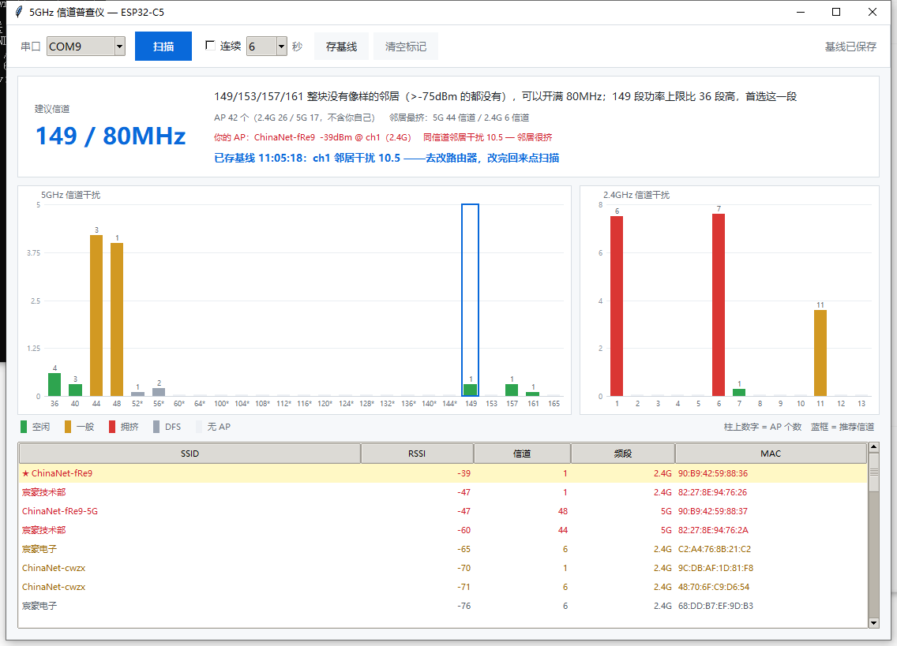

# ESP32-C5 5GHz 信道普查仪

把一块 **ESP32-C5** 变成手持 Wi-Fi 现场勘查仪：扫出周围所有接入点，算出 5GHz 哪个信道最干净，告诉你路由器该改到哪，并量化改前改后的差异。

> **在线版（免安装）**
> 项目主页 <https://xieyangshenshanglin.github.io/esp32-c5-5g-channel-surveyor/>
> 网页烧录台 <https://xieyangshenshanglin.github.io/esp32-c5-5g-channel-surveyor/flasher.html> —— Chrome/Edge 打开，插上板子就能刷固件，不用装 Python 和 esptool



## 解决什么问题

- 家里 Wi-Fi 高峰期卡，到底是不是因为邻居挤在同一信道？
- 路由器后台那一排信道，选 36 还是 149？
- 改完之后有变好吗，还是白折腾？

手机 App 看不到这些——系统只返回连过的和信号强的 AP。ESP32 是主动全信道扫描，一次能看到 40+ 个接入点，而且 2.4GHz 和 5GHz 一起扫。

## 特性

| | |
|---|---|
| **双频全扫** | 2.4GHz 13 个信道 + 5GHz 25 个信道，一次 8 秒 |
| **加权干扰分** | 不是数 AP 个数，按 RSSI 赋权——一个 -40dBm 的隔壁路由器比十个 -90dBm 的远邻居更值得躲 |
| **四阶段判定** | 优先保住带宽：整块 80MHz 干净就上 80MHz，其次 40MHz，再其次 20MHz，DFS 是最后选项 |
| **排除自己** | 双击标记"你的 AP"，统计时把它摘出去，避免"搬到空房间之后嫌自己占地方"的荒谬结论 |
| **改前改后对比** | 存基线 → 改信道 → 重新扫描，直接给出「干扰 3.3 → 0.3，改善 91%」 |
| **实时图形界面** | tkinter 自绘，零第三方依赖，扫描结果直接出柱状图 |
| **单文件报告** | 导出 HTML，不联网也能看，可以直接发给别人 |
| **连续监测** | 挂着跑一晚上，看出「晚上 8-11 点信道全被占」这种时间规律 |

## 快速开始

### 1. 刷固件（只做一次）

本项目的固件修复了原版在**无屏 ESP32-C5 板子上跑不了 JavaScript 解释器**的三个 bug，并启用了 8MB PSRAM。详见 [源码改动说明.md](源码改动说明.md)。

#### 方式一：网页烧录台（推荐，不用装任何东西）

用 **Chrome 或 Edge** 打开 [`flasher.html`](flasher.html)（或直接双击仓库里的这个文件），然后：

1. 点「选择串口并连接」，选板子对应的 COM 口
2. 把 `firmware/Bruce-c5-n32r8-chan5g.bin` 拖进「2 选择固件」
3. 点「开始烧录」

用的是浏览器自带的 **Web Serial API** + 自实现的 ESP ROM 下载协议，固件只在内存里直写芯片，不上传任何服务器。Safari 和 Firefox 不支持 Web Serial。

#### 方式二：命令行

```powershell
cd firmware
python -m esptool --chip esp32c5 -p COM9 -b 921600 write-flash -z `
  --flash-mode dio --flash-freq 80m --flash-size 32MB `
  0x0 Bruce-c5-n32r8-chan5g.bin
```

Windows 用户也可以直接双击 `firmware/刷机.bat`。

### 2. 启动界面

双击 `pc/启动界面.bat`，或者：

```powershell
cd pc
python chan5g_gui.py
```

串口会自动按 Espressif 厂商 ID 识别，不用手填。点「扫描」，8 秒出结果。

### 3. 改信道

看界面上的建议，去路由器后台改。国内住宅区 5GHz 的出厂默认值基本挤在 36/44/48，改到 149/153/157/161 段通常立刻见效。分品牌操作步骤见 [改信道操作卡.md](改信道操作卡.md)。

## 仓库结构

```
├── index.html               项目落地页（可开 GitHub Pages）
├── flasher.html             网页烧录台：浏览器直接刷固件，免安装
├── 使用说明.md              完整使用文档（11 章，含故障排查 25 条）
├── 源码改动说明.md          三个固件 bug 的完整 diff 和编译步骤
├── 改信道操作卡.md          分品牌改信道步骤 + 从 MAC 前缀认厂商
├── 界面截图.png
├── firmware/
│   ├── Bruce-c5-n32r8-chan5g.bin   定制固件（4.0MB）
│   └── 刷机.bat
├── pc/                      上位机（Python，只需 pyserial）
│   ├── chan5g_gui.py        图形界面
│   ├── chan5g_report.py     HTML 报告渲染器
│   ├── chan5g_show.py       一键出报告
│   ├── bruce_push.py        串口底层
│   └── chan5g_selftest.js   离线自测（node）
└── device/                  设备端脚本（JavaScript）
    ├── scanjson.js          单轮扫描，界面用
    ├── chan5g.js            三轮扫描 + 落盘 CSV
    └── dump.js              把 CSV 吐回串口
```

## 原理

### 干扰分怎么算

先按信号强度给每个 AP 赋权：

| RSSI | 权重 |
|---|---|
| ≥ -60 dBm | 3.0 |
| ≥ -70 dBm | 2.0 |
| ≥ -80 dBm | 1.0 |
| ≥ -88 dBm | 0.3 |
| 更弱 | 0.1 |

信道干扰分 = 该信道上所有 AP 权重之和，如果该信道最强 AP ≥ -70dBm 再额外 +1.0。

这样一堆 -90dBm 的远邻居不会把分数堆起来，而一个 -50dBm 的强邻居会明显抬高分数。

### 四阶段判定

**80MHz 带来的速度提升，远大于从拥挤信道换到空闲信道的收益。** 所以判定顺序是：

1. 整块 80MHz 都干净（块内没有强于 -75dBm 的邻居）→ 上 80MHz
2. 两相邻信道干净 → 上 40MHz
3. 有单个清净信道 → 退到 20MHz
4. 非 DFS 全废 → 才考虑 DFS，并明确警告

`-75dBm` 这条线的理由：隔两堵墙的 -85dBm 邻居，在 80MHz 整段频谱里对你几乎没有影响，为它放弃整段频谱不值。这个值写在 `chan5g_report.py` 的 `NOISE_FLOOR`，可以自己调。

### 数据流

```
ESP32-C5  wifi.scan()
    ↓
scanjson.js  → 串口逐行输出 SSID / MAC / RSSI / 信道
    ↓
bruce_push.py  → do_cmd() 边跑边收（USB CDC 缓冲只有几 KB，不能等结束了再读）
    ↓
chan5g_gui.py  → 解析 → aggregate() 统计 → advise() 判定
    ↓
tkinter Canvas  → 柱状图 + 表格
```

## 硬件要求

- **ESP32-C5-WIFI6-KIT-N32R8**（32MB Flash / 8MB PSRAM）
- 一根**能传数据**的 USB 线

> 芯片本身没有 USB OTG、没有经典蓝牙、没有 RF433/NRF24/PN532/GPS/LoRa，所以本项目的功能都限定在 Wi-Fi 和 BLE 上。

## 环境

| | |
|---|---|
| Python | 3.8+ |
| pyserial | 必需（`pip install pyserial`）|
| esptool | 仅刷固件需要（`pip install esptool`）|
| tkinter | Python 自带 |
| node | 仅跑离线自测需要 |

## 已知限制

- **不能**自动改路由器——没有管理员权限，各家后台协议不同
- **不能**测实际网速——这是信号环境分析工具
- **不能**看到连在路由器上的客户端设备——Wi-Fi 扫描只能看到 AP
- **看不到** 160MHz 带宽——ESP32-C5 的扫描不返回带宽字段
- **不能**脱机记录——需要电脑一直连着串口

关于 2.4GHz：如果扫出来 1/6/11 三个非重叠信道全挤满（国内住宅区基本如此），这是无解的。2.4GHz 只有 3 个不重叠信道，一个小区几十户人家，数学上就不够分。**不要把精力浪费在优化 2.4G 上。**

## 参考

- [Bruce](https://github.com/pr3y/Bruce) —— 本项目固件基于其 `firmware-main` 分支的三个 bug 修复
- ESP-IDF 的 `esp_wifi_scan_start()` / `esp_wifi_set_band_mode()`

## License

MIT
