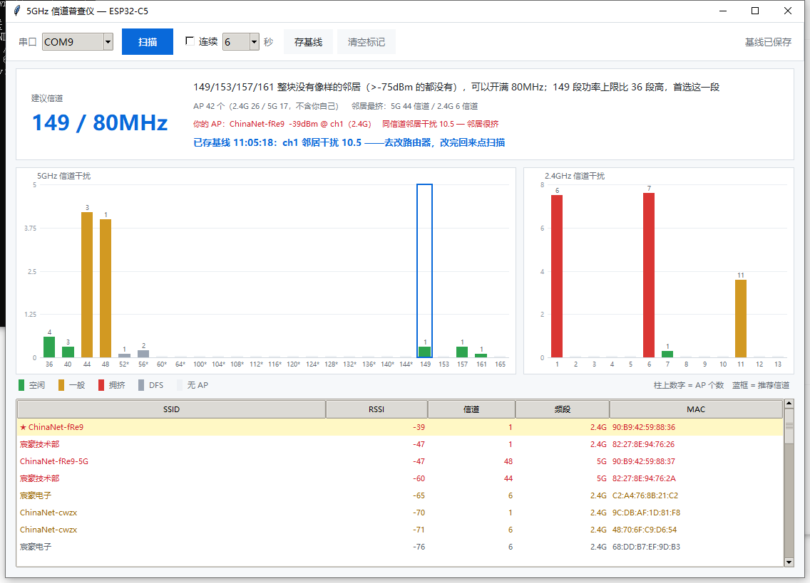

# ESP32-C5 5GHz 信道普查仪 · 使用说明

版本 **1.0** ｜ 2026-10-24 ｜ 硬件 ESP32-C5-WIFI6-KIT-N32R8（32MB Flash / 8MB PSRAM）

---

## 目录

- [一、这是什么](#一这是什么)
- [二、包里有什么](#二包里有什么)
- [三、你需要准备什么](#三你需要准备什么)
- [四、第一次使用：刷固件](#四第一次使用刷固件)
- [五、日常使用：图形界面](#五日常使用图形界面)
- [六、出报告](#六出报告)
- [七、改信道](#七改信道)
- [八、故障排查](#八故障排查)
- [九、技术细节](#九技术细节)
- [十、自己改代码](#十自己改代码)
- [十一、能力边界](#十一能力边界)

---

## 一、这是什么

一块 ESP32-C5 开发板，配上改装过的 Bruce 固件和电脑端界面，做的事只有一件：

**扫出你周围所有的 Wi-Fi 接入点（包括 5GHz），告诉你 5GHz 的哪个信道最干净、该把路由器改到哪，以及改完之后到底有没有变好。**

它解决的具体问题：

- 你家的 Wi-Fi 高峰期卡，到底是不是因为邻居挤在同一信道？
- 路由器后台那一排信道，选 36 还是 149？
- 改完之后有变好吗，还是白折腾？

界面长这样：



**为什么用 ESP32 而不是手机 App：**

手机 Wi-Fi 扫描是"被阉割"的——系统只返回连过的和信号强的，很多 AP 根本看不到。ESP32 这边是主动全信道扫描，一次能看到 40 个以上 AP，而且能同时扫 2.4GHz 和 5GHz。

---

## 二、包里有什么

```
ESP32-C5-5G普查仪-v1.0/
│
├── 使用说明.md                      本文件
├── 改信道操作卡.md                  改路由器信道的详细步骤（分品牌）
│
├── firmware/                        ── 固件（刷一次就够）
│   ├── Bruce-c5-n32r8-chan5g.bin    定制固件，4.0MB
│   └── 刷机.bat                     一键刷写脚本
│
├── pc/                              ── 上位机（电脑端）
│   ├── 启动界面.bat                 【最常用】双击启动图形界面
│   ├── 一键出报告.bat               跑三轮扫描 + 生成 HTML 报告
│   ├── chan5g_gui.py                图形界面主程序
│   ├── chan5g_show.py               出报告的一键脚本
│   ├── chan5g_report.py             HTML 报告渲染器
│   └── bruce_push.py                串口底层（上传脚本、发命令、读输出）
│
└── device/                          ── 设备端脚本（源码，供修改用）
    ├── scanjson.js                  界面用的单轮扫描（GUI 会自动上传）
    ├── chan5g.js                    三轮扫描 + 落盘 CSV（出报告用）
    └── dump.js                      把设备上的 CSV 吐回串口
```

**普通用户只用 `pc/` 里的两个 .bat，其它都是源码。**

---

## 三、你需要准备什么

### 硬件

- ESP32-C5-WIFI6-KIT-N32R8 开发板一块（32MB Flash + 8MB PSRAM 那款）
- 一根**能传数据**的 USB 线（很多充电线只有电源线，插上电脑认不到串口）
  - 板子走的是 USB Serial/JTAG，插上电脑会显示为 `USB 串行设备 (COMx)`

### 软件

| 软件 | 要求 | 检查方法 |
|---|---|---|
| Python | 3.8 或更新 | 命令行敲 `python --version` |
| pyserial | 必需 | `python -c "import serial"` 不报错即可 |
| esptool | 只有刷固件需要 | `python -m esptool version` |
| tkinter | Python 自带 | 一般不用管 |
| 浏览器 | 任意 | 只有看报告用 |

缺的东西一条命令装齐：

```powershell
python -m pip install pyserial esptool
```

`启动界面.bat` 会自动检测 pyserial，缺了会帮你装。

---

## 四、第一次使用：刷固件

**这一步只做一次。** 板子如果已经是本包里的固件，直接跳到第五节。

### 4.1 为什么必须刷这个固件

板子出厂固件（或网上的通用 Bruce 固件）跑不了本工具，原因是三个真实的 bug：

1. **无屏构建下 JS 解释器永远启动不了**——固件里启动解释器的代码写在"有屏幕"的分支里，无头板子走不到那里
2. **解释器任务句柄不清空**——第一次跑完脚本，第二次就再也起不来
3. **PSRAM 没启用**——8MB 内存没打开，JavaScript 堆只剩 7KB，`wifi.scan()` 直接因为内存不足返回 0 个 AP

本包里的固件已经把这三处修好，并且启用了 PSRAM。

### 4.2 刷写

1. USB 线连上板子
2. 关闭所有可能占用串口的程序（串口助手、Arduino IDE、PlatformIO 的监视器）
3. 双击 `firmware/刷机.bat`
4. 它会列出当前可用的串口，输入板子那个（例如 `COM9`）
5. 等 20 秒左右

成功的话会看到：

```
Wrote 4186464 bytes (2421659 compressed) at 0x00010000 in 17.8s...
Hash of data verified.
```

### 4.3 手动刷（.bat 用不了时）

```powershell
cd firmware
python -m esptool --chip esp32c5 -p COM9 -b 921600 write-flash -z `
  --flash-mode dio --flash-freq 80m --flash-size 32MB `
  0x0 Bruce-c5-n32r8-chan5g.bin
```

把 `COM9` 换成你的实际串口。串口号在**设备管理器 → 端口(COM 和 LPT)** 里看。

### 4.4 刷完怎么确认正常

拔插一次 USB，然后：

```powershell
cd pc
python bruce_push.py cmd "info"
```

应该返回类似：

```
Bruce vdev
Homebrew
SDK: v5.5.4-dirty
MAC addr: 10:BD:A3:DD:96:EC
Device: ESP32-C5
```

再验证 PSRAM 和 WiFi 都正常：

```powershell
python bruce_push.py cmd "js /scripts/scanjson.js"
```

如果回一堆 `SSID<TAB>MAC<TAB>-45<TAB>48` 这样的行，说明一切就绪。

---

## 五、日常使用：图形界面

### 5.1 打开

双击 `pc/启动界面.bat`。

或者命令行：

```powershell
cd pc
python chan5g_gui.py
```

串口下拉框会**自动选中 Espressif 设备**（按厂商 ID 识别，不用手填）。

### 5.2 界面上每个元素是什么意思

#### 顶部工具条

| 控件 | 作用 |
|---|---|
| **串口下拉框** | 换板子时在这里切换 |
| **扫描** | 扫一次，大约 8 秒 |
| **连续** | 勾上后自动反复扫描 |
| **间隔**（秒） | 连续模式下的扫描间隔，3/5/6/10/15/30 |
| **存基线** | 把当前状态存下来，用来对比改信道前后的差异 |
| **清空标记** | 清掉"你的 AP"标记和基线 |
| **导出报告** | 把当前这次扫描直接生成 HTML 报告并打开 |
| **右上角状态** | 显示"上次扫描 11:05:18"或错误信息 |

#### 结论卡

```
建议信道
149 / 80MHz          ← 大号蓝字，直接告诉你改到哪

149/153/157/161 整块没有像样的邻居（>-75dBm 的都没有），可以开满 80MHz；
149 段功率上限比 36 段高，首选这一段        ← 判定依据

AP 42 个（2.4G 26 / 5G 17，不含你自己）  邻居最挤：5G 44 信道 / 2.4G 6 信道
你的 AP：ChinaNet-fRe9-5G  -49dBm @ ch48（5G）  同信道邻居干扰 3.3 — 邻居很挤
```

**"你的 AP"这一行**只有在你双击表格标记之后才会出现。

#### 两张柱状图

- **左：5GHz 25 个信道**，蓝框 = 推荐信道
- **右：2.4GHz 13 个信道**
- 柱子上面的数字 = 该信道有几个 AP
- 带 `*` 的信道 = DFS 信道（雷达频段，国内设备经常不认，能不选就不选）

颜色含义：

| 颜色 | 干扰分 | 含义 |
|---|---|---|
| 绿 | < 2 | 空闲，可以放心用 |
| 黄 | 2 ～ 5 | 一般，能用但别指望快 |
| 红 | ≥ 5 | 拥挤，能躲就躲 |
| 灰 | — | DFS 信道 |
| 浅灰条 | — | 这个信道一个 AP 都没有 |

#### AP 列表

按信号强度从强到弱排。字体颜色：

- **红**：≥ -60dBm（很近，可能是你自己的）
- **黄**：-60 ~ -75dBm（中等距离）
- **灰**：< -75dBm（很远，隔了好几堵墙）

**双击某一行 = 把它认成"你的 AP"**，该行变黄底 + SSID 前加 ★。这个动作很重要，原因见 [9.3](#93-为什么要把你自己的-ap-排除掉)。

### 5.3 完整体验流程

```
1. 双击表格里属于你自己的那个 SSID（通常信号最强、名字你认识）
   ↓
2. 点「存基线」 —— 记住你现在有多挤
   ↓
3. 去路由器改信道（见第七节）
   ↓
4. 回来点「扫描」
   ↓
5. 看对比行：基线 11:05:18：ch48 干扰 3.3 → 现在 ch149 干扰 0.3   改善 91%
```

看到这个数字，才知道改信道到底值不值。

### 5.4 连续模式怎么用

勾上「连续」，间隔选 30 秒，让它挂着跑一晚上。

第二天早上你会看到：**信道占用是随时间变化的**。

- 白天邻居上班，5G 干净
- 晚上 8～11 点全家都在刷视频，信道全被占

单次扫描只是快照，看不出这个规律。**"我家 Wi-Fi 为什么晚上卡"这种问题，只有连续监测能回答。**

### 5.5 命令行模式（没有图形界面时）

```powershell
# 单次验证链路
python chan5g_gui.py --test

# 指定串口
python chan5g_gui.py --port COM9

# 演示模式：自动把最强 AP 认成你的并存基线
python chan5g_gui.py --demo
```

---

## 六、出报告

两种方式：

### 方式一：界面里点「导出报告」

扫到你满意的数据后，点工具条上的「导出报告」，会在 `pc/` 目录生成：

```
chan5g_report_20261024_110518.html
```

并自动用浏览器打开。**单文件，可以直接发给别人**，不需要联网。

### 方式二：跑完整三轮扫描

双击 `pc/一键出报告.bat`，或者：

```powershell
cd pc
python chan5g_show.py
```

它会：
1. 自动上传 `dump.js` 到板子
2. 读取板子上已有的 CSV
3. 生成 HTML 并打开

**注意**：这个方式需要板子上已经有 CSV。CSV 是 `chan5g.js` 跑出来的，界面的扫描不会写 CSV。

想让板子重新跑一次三轮扫描并落盘：

```powershell
python bruce_push.py cmd "js /scripts/chan5g.js" --wait 160
```

约 50 秒跑完，输出 `/chan5_sum.csv`（每轮一行）和 `/chan5_raw.csv`（每个 AP 一行）。

### 报告里有什么

| 区块 | 内容 |
|---|---|
| 四张数字卡 | AP 总数 / 建议信道 / 5G 最挤 / 2.4G 最挤 |
| 结论 | 建议什么信道、依据是什么、怎么改 |
| 5GHz 柱状图 | 25 个信道的干扰分布，蓝框标推荐 |
| 2.4GHz 柱状图 | 13 个信道的真实拥挤度 |
| 信号强度分布 | 有多少 AP 强于 -70dBm（真正干扰你的） |
| 5G 信道明细表 | 每个信道的 AP 数、最强、平均、干扰、状态、最强那个是谁 |
| 多轮对比 | 三轮分别建议了什么，稳不稳定 |

---

## 七、改信道

**详细的分品牌步骤见 `改信道操作卡.md`**，这里给要点。

### 从扫描数据认出你的路由器

MAC 地址前三段（OUI）能看出厂商：

| OUI 前缀 | 厂商 | 常见于 |
|---|---|---|
| `90:B9:42` / `9C:DB:AF` / `48:70:6F` | 华为 | 电信/联通光猫 |
| `F4:3A:7B` | 华为 | 华为路由器 |
| `82:` / `C2:` / `9E:` | 随机 MAC | 企业 AP、虚拟 SSID、开了隐私功能的设备 |

前缀是 `ChinaNet-` 的，是中国电信出厂默认 SSID。

### 通用四步

1. 看路由器背面贴纸，确认 SSID 和管理地址
2. 浏览器打开管理地址（电信光猫一般是 `192.168.1.1`）
3. 登录，找到无线/5G 设置里的「信道」
4. 改成 **149**，带宽 **80MHz**，保存

### 改完会怎样

- 5G Wi-Fi 断 30～60 秒，正常
- 手机可能需手动重连一次
- 2.4G 通常不受影响

### 为什么是 149

| | 36 段（36/40/44/48） | 149 段（149/153/157/161） |
|---|---|---|
| 邻居数量 | 几乎所有人都在这里 | 通常没人 |
| 功率上限 | 较低 | **较高，穿墙更好** |
| 兼容性 | 全支持 | 2020 年后的设备都支持 |

买了路由器从来不改信道是国内常态，所以出厂默认的 36/44/48 永远是最挤的。

---

## 八、故障排查

### 8.1 串口相关

| 现象 | 原因 | 解决 |
|---|---|---|
| 下拉框里没有串口 | 线是充电线 / 驱动没装 | 换数据线；设备管理器看有没有 `USB 串行设备` |
| `PermissionError: 拒绝访问` | 串口被别的程序占着 | 关掉串口助手、Arduino IDE、PlatformIO Monitor |
| 串口号变了 | 换了 USB 口，系统重新分配 | 下拉框里换一个，或者在设备管理器里固定端口号 |
| 一开界面板子就重启 | pyserial 默认会拉 RTS 造成复位 | 本包代码已规避（`dtr=False, rts=False`），若自行改代码请保留这段 |

### 8.2 扫描相关

| 现象 | 原因 | 解决 |
|---|---|---|
| 扫到 0 个 AP | 固件没开 PSRAM，JS 堆不足 | 重刷本包固件 |
| 扫到 0 个 AP | 板子启动时 WiFi 初始化失败 | `python bruce_push.py cmd "wifi on"` 后重试 |
| 只有 2.4G 没有 5G | 固件不支持双频 | 重刷本包固件（C5 必须走 `WIFI_BAND_MODE_AUTO`） |
| 扫描一直卡住 | 脚本报错但没输出 | 去掉 `--quiet` 参数重跑，看完整输出 |
| 手机热点扫不到 | 手机热点在 5GHz 上默认用 36-48 | 正常，不是工具问题 |

### 8.3 界面相关

| 现象 | 原因 | 解决 |
|---|---|---|
| `ModuleNotFoundError: serial` | 没装 pyserial | `python -m pip install pyserial` |
| 界面打开但空白 | 还没扫描 | 点「扫描」 |
| 表格里找不到你的 AP | 开了随机 MAC / 关机了 | 重新扫描；或双击别的行重新认 |
| 对比行不出现 | 没存基线，或没标记你的 AP | 先双击标记 → 再存基线 |
| 中文显示成方块 | 系统缺字体 | 一般 Win10+ 无此问题 |

### 8.4 数据相关

| 现象 | 原因 | 解决 |
|---|---|---|
| `ERR: File is too big` | CLI 的 `storage read` 有大小限制 | 用界面的「导出报告」，或用 `dump.js` |
| CSV 是空的 | 没跑过 `chan5g.js` | 跑一次 `js /scripts/chan5g.js` |
| 脚本传上去大小不对 | 串口按块灌数据会丢字节 | 本包的 `bruce_push.py` 已改成逐行发送，若自行修改请保留 |

### 8.5 刷机相关

| 现象 | 原因 | 解决 |
|---|---|---|
| `esptool: command not found` | 没装 | `python -m pip install esptool` |
| `Failed to connect` | 串口不对 / 板子没进下载模式 | 确认串口；按住 BOOT 再插 USB |
| 刷完不能用 | 刷错型号 | 必须用 `n32r8`（32MB Flash）那一版 |
| 刷完没变 | 刷到了旧 bin | 确认刷的是本包的 4186464 字节那个 |

---

## 九、技术细节

给想知道原理的人。

### 9.1 扫描是怎么实现的

设备端脚本只有三行核心（`scanjson.js`）：

```javascript
var wifi = require('wifi');
var aps = wifi.scan();
// 每个 AP 输出：SSID \t MAC \t RSSI \t channel
```

底层是 ESP-IDF 的 `esp_wifi_scan_start()`，主动扫描所有信道。

**5GHz 怎么扫到的**：ESP32-C5 是双频芯片，Arduino 核心在初始化时执行了：

```c
#if SOC_WIFI_SUPPORT_5G
  esp_wifi_set_band_mode(WIFI_BAND_MODE_AUTO);
#endif
```

所以默认就是 2.4G + 5G 一起扫，不需要手动切换。

### 9.2 干扰分怎么算的

一个信道的"拥挤程度"不是简单数 AP 个数。因为**一个 -90dBm 的远邻居，和一个 -40dBm 的隔壁路由器，造成的干扰差了十倍不止**。

所以先给每个 AP 按信号强度赋权：

| RSSI | 权重 |
|---|---|
| ≥ -60 dBm | 3.0 |
| ≥ -70 dBm | 2.0 |
| ≥ -80 dBm | 1.0 |
| ≥ -88 dBm | 0.3 |
| 更弱 | 0.1 |

信道的干扰分 = 该信道上所有 AP 权重之和 + 一个"有没有强敌"的加分：

```python
score = sum(weights)
if 该信道最强 AP >= -70dBm:
    score += 1.0      # 有强邻居，额外惩罚
```

这样 -70dBm 以下一堆远邻居不会把分数堆起来，而一个 -50dBm 的强邻居会明显抬高分数。

### 9.3 为什么要把你自己的 AP 排除掉

这是本工具一个关键设计。

假设你把路由器从 48 改到 149。改完扫描，**你自己的 AP 也在 149 上，还 -45dBm 全场最强**。

如果把它算进统计，工具会认为"149 信道有 1 个 -45dBm 的强 AP，很挤"——**然后建议你搬到别的地方去**。这显然是荒谬的。

所以双击标记之后，统计时把你的 AP 摘出去，**只看邻居**。你搬家搬到一个空房间，不能说"这个房间被我占了所以很挤"。

### 9.4 四阶段判定

推荐信道不是"挑分数最低的那个"这么简单，因为带宽比信道更重要：

**80MHz 带来的速度提升，远大于从拥挤信道换到空闲信道的收益。**

所以判定按这个顺序：

1. **整块 80MHz 都干净？** → 上 80MHz
   （149/153/157/161 或 36/40/44/48，块内没有强于 -75dBm 的邻居）
2. **两相邻信道干净？** → 上 40MHz
3. **有单个清净信道？** → 退到 20MHz
4. **非 DFS 全废？** → 才考虑 DFS，并且明确警告

### 9.5 -75dBm 这条线怎么来的

判定"某个信道算不算被占"用 `-75dBm`，而不是"有没有 AP"。

理由：**隔两堵墙的 -85dBm 邻居，在 80MHz 的整个频段里对你几乎没有影响**。为了它放弃整段频谱，得不偿失。

而 -70dBm 以上是"真干扰"——它会参与 CSMA/CA 竞争，实际拉低你的吞吐。

这个门限写在 `chan5g_report.py` 的 `NOISE_FLOOR = -75`，想调可以直接改。

### 9.6 数据流

```
ESP32-C5
  wifi.scan()
      ↓
  scanjson.js  → 串口逐行输出 SSID/MAC/RSSI/信道
      ↓
bruce_push.py  → do_cmd() 边跑边收（USB CDC 缓冲只有几 KB，不能等结束了再读）
      ↓
chan5g_gui.py  → parse_scan() 解析 → rep.aggregate() 统计 → rep.advise() 判定
      ↓
tkinter Canvas  → 柱状图 / 表格
```

### 9.7 为什么串口读取要特殊处理

两个坑，都是真机踩出来的：

1. **扫描期间会静默 7 秒**。如果按"静默 2 秒就算结束"来判断，会误认为扫描完成、返回 0 个 AP。所以加了 `until=b">>>END"` 参数——看到结束标记才返回。

2. **USB CDC 接收缓冲只有几 KB**。如果先 `sleep(30)` 再读，只能拿到最后几 KB，前面的全丢了。所以必须边跑边收。

### 9.8 固件改了什么

见 `源码改动说明.md`（如果有单独的源码包）。三处：

| 文件 | 问题 | 修法 |
|---|---|---|
| `src/main.cpp` | 无屏构建不启动解释器 | 在无头 loop 里补 `interpreter_state = 2` |
| `src/modules/bjs_interpreter/interpreter.cpp` | 任务句柄不清空，第二次跑不了 | `vTaskDelete(NULL)` 前加 `interpreterTaskHandler = NULL` |
| `boards/_boards_json/esp32-c5-n32r8.json` + `boards/ESP32-C5/ESP32-C5.ini` | PSRAM 未启用 | 加 `-DBOARD_HAS_PSRAM` 和 `board_build.arduino.memory_type = dio_qspi` |

---

## 十、自己改代码

### 设备端（JavaScript）

`device/` 下三个脚本，改完用 `bruce_push.py` 上传：

```powershell
cd pc
python bruce_push.py push ..\device\scanjson.js /scripts/scanjson.js
```

注意：**界面每次启动会自动上传 `scanjson.js`**，所以改了这个文件不用手动传，但改了别的要传。

设备端可用的 API 全在固件里，常用的：

```javascript
var wifi    = require('wifi');      // scan / connect / httpFetch
var storage = require('storage');   // read / write / readdir
var serial  = require('serial');    // print / println
var ble     = require('ble');       // scan / advertise / stopAdvertise
var display = require('display');   // 无屏板子上没有实际作用
```

`storage.write` 默认是**追加模式**，要覆盖必须显式传：

```javascript
storage.write({fs:'littlefs', path:'/x.csv'}, data, 'write');
```

`storage.read` 读不存在的文件会**抛异常**，不是返回 false，要包 try/catch。

### 电脑端（Python）

三个文件职责清晰：

- `bruce_push.py` — 只管串口：开端口、传文件、发命令、读输出
- `chan5g_report.py` — 只有算法和 HTML：`aggregate` / `advise` / `build_html`
- `chan5g_gui.py` — 只管界面

想改判定逻辑，动 `chan5g_report.py` 里的 `advise()` 和 `NOISE_FLOOR`。界面和报告会同时生效，因为两者共用这一份代码。

### 离线自测

不用连板子也能验证算法：

```powershell
cd pc
node chan5g_selftest.js    # 需要 node，会跑三组假数据并打印判定结果
```

（这个文件在完整源码包里，发行包没带）

---

## 十一、能力边界

### 能做

- 扫 2.4GHz + 5GHz 全部 38 个信道，列出所有 AP
- 计算出哪个信道最干净，给出具体到信道的建议
- 连续监测，发现拥堵的时间规律
- 生成可发给别人的 HTML 报告
- 改信道前后做量化对比

### 不能做

| 想做的事 | 为什么不行 |
|---|---|
| **自动帮你改路由器** | 没有路由器管理员权限，各家后台协议都不同 |
| **测实际网速** | 这是信号环境分析工具，不是测速工具。测速用 Speedtest |
| **看到连在路由器上的设备** | Wi-Fi 扫描只能看到 AP（路由器），看不到客户端（手机电脑） |
| **判断哪个 AP 是你的** | 只能靠信号强度和 SSID 猜，所以要你双击确认 |
| **看到 160MHz 带宽** | ESP32-C5 的扫描不返回带宽字段，只能用信道号推断 |
| **长时间无人值守记录** | 需要电脑一直连着串口。想脱机记录得自己写 SD 卡版本 |
| **穿越楼层测** | 2.4G 能穿一两层，5G 穿一堵承重墙就废，这是物理规律 |

### 关于 2.4GHz 的残酷现实

如果你扫出来 2.4G 的 1/6/11 三个信道全都挤满了（国内住宅区基本都这样），**这是无解的**。

2.4GHz 只有 3 个不重叠信道，一个小区几十户人家，数学上就不够分。

对策只有两个：
- 上 5GHz（这正是本工具存在的意义）
- 用 2.4G 时接受它就是个"能连上就行"的频段

**不要把精力浪费在优化 2.4G 上。**

---

## 附：快速命令速查

```powershell
# 进目录
cd pc

# 启动界面
python chan5g_gui.py

# 验证链路（不开窗，跑一次打印结果）
python chan5g_gui.py --test

# 发任意 CLI 命令
python bruce_push.py cmd "info"
python bruce_push.py cmd "storage free littlefs"

# 上传脚本
python bruce_push.py push ..\device\chan5g.js /scripts/chan5g.js

# 跑三轮扫描并落盘 CSV（约 50 秒）
python bruce_push.py cmd "js /scripts/chan5g.js" --wait 160

# 从板子取 CSV 出报告
python chan5g_show.py

# 看板子上的文件
python bruce_push.py cmd "storage list /scripts"
```

---

**问题反馈**：这套东西是针对 ESP32-C5 定制的，换芯片、换板子都需要重新适配。使用中遇到本说明没覆盖的情况，带上完整报错信息。
